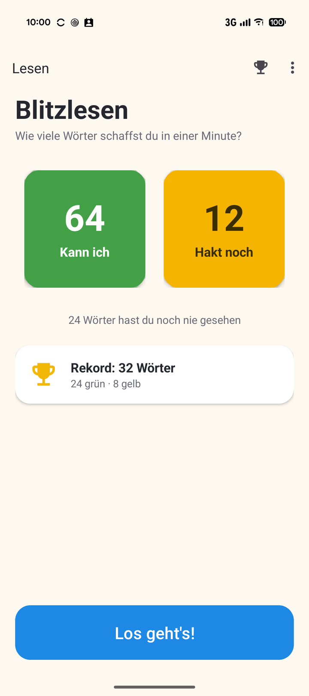
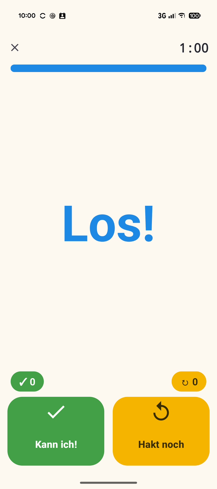
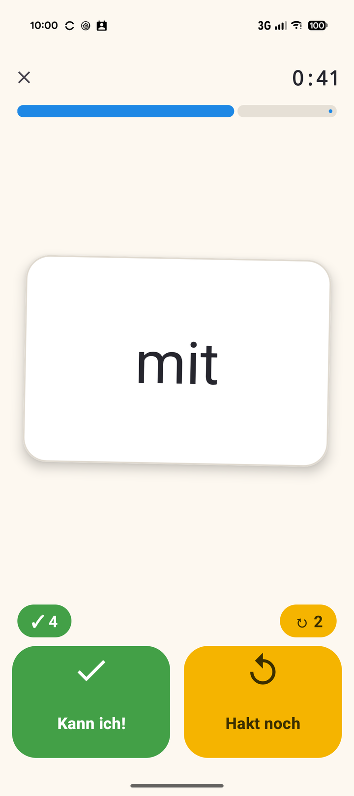
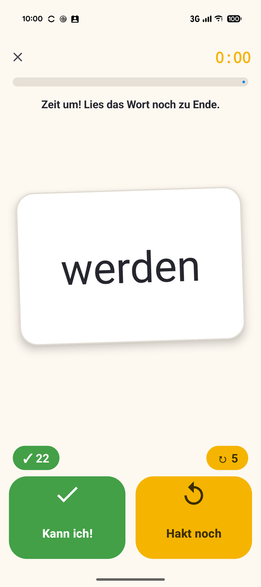
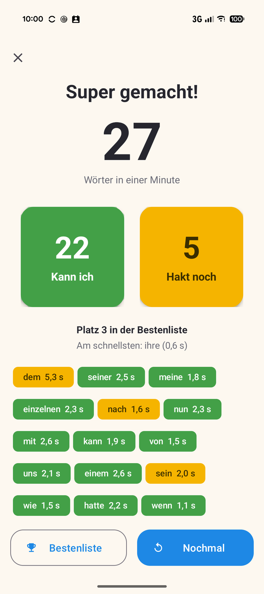
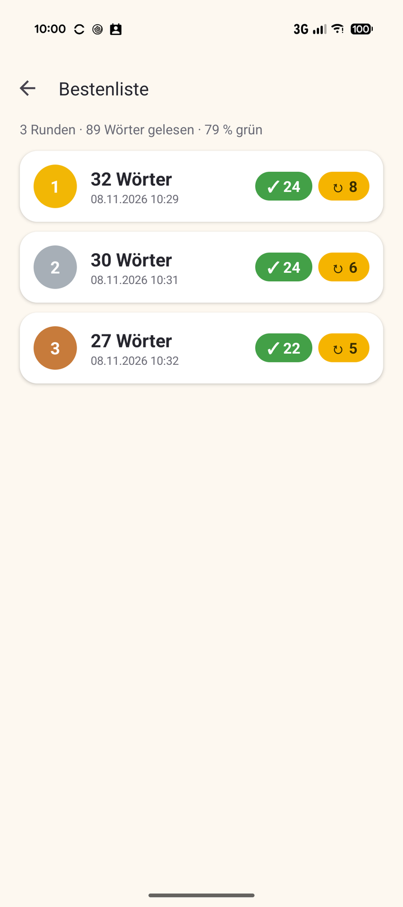
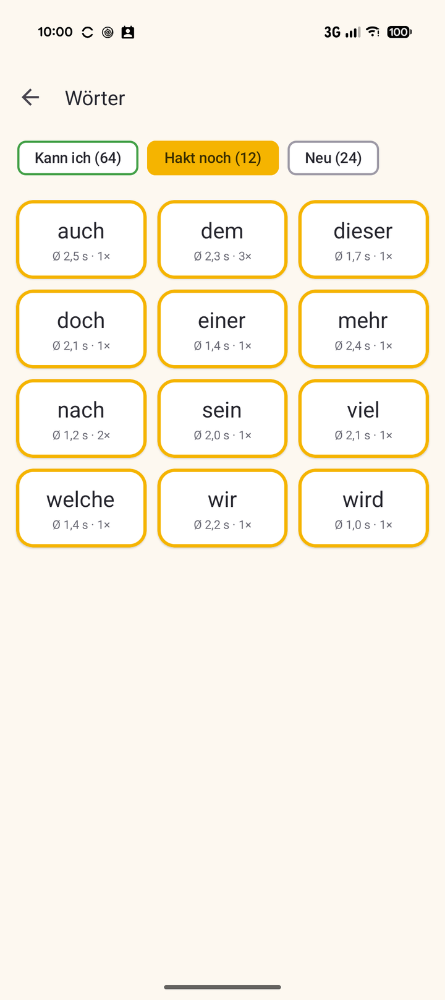
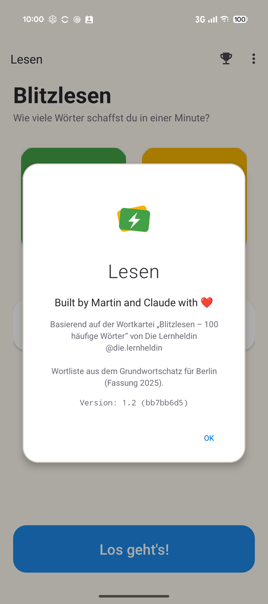

# Blitzlesen als App

Eine kleine Web-App (und Android-App), die die Wortkartei **„Blitzlesen – 100 häufige Wörter“ von
[Die Lernheldin](https://www.instagram.com/die.lernheldin/)** aufs Handy, Tablet oder an den
Computer bringt. Entstanden ist sie für den Hausgebrauch, damit ein Grundschulkind mit den Karten
auch unterwegs üben kann. Die Idee, die Wortauswahl und die Übungsweise mit den zwei Stapeln stammen
aus der Kartei; die App setzt sie nur in eine spielerische Form um.

**Direkt im Browser ausprobieren:** <https://hansmaulwurf23.github.io/blitzlesen/>

## So funktioniert's

Eine Runde dauert **eine Minute**. Die App zeigt eine zufällige Karte nach der anderen, das Kind liest
das Wort vor und tippt dann selbst:

- **Grün – „Kann ich!“**: Das Wort ging schon flüssig.
- **Gelb – „Hakt noch“**: Das Wort hat noch etwas gehakt.

Daraus entstehen dieselben zwei Stapel wie bei den Papierkarten: sichere Wörter und Übungswörter.
Übungswörter und noch nie gesehene Wörter kommen öfter dran als sichere, aber auch die sicheren
Wörter kehren regelmäßig wieder.

<table>
<tr>
<td width="50%"></td>
<td width="50%"></td>
</tr>
<tr>
<td><b>Start:</b> die beiden Stapel, wie viele Wörter noch neu sind, und der Rekord.</td>
<td><b>Countdown:</b> „3, 2, 1, Los!“, dann läuft die Minute.</td>
</tr>
<tr>
<td width="50%"></td>
<td width="50%"></td>
</tr>
<tr>
<td><b>Karte:</b> großes Wort, darunter Grün und Gelb. Die Karte fliegt auf ihren Stapel, die nächste springt herein.</td>
<td><b>Zeit um:</b> Das angefangene Wort darf noch zu Ende gelesen werden.</td>
</tr>
<tr>
<td width="50%"></td>
<td width="50%"></td>
</tr>
<tr>
<td><b>Ergebnis:</b> wie viele Wörter, davon grün und gelb, und jedes Wort mit seiner Lesezeit.</td>
<td><b>Bestenliste:</b> alle Runden, die meisten Wörter oben.</td>
</tr>
<tr>
<td width="50%"></td>
<td width="50%"></td>
</tr>
<tr>
<td><b>Stapel:</b> welche Wörter gerade wo liegen, mit durchschnittlicher Lesezeit.</td>
<td><b>Über die App:</b> der Hinweis auf die Kartei und die Wortliste.</td>
</tr>
</table>

## Was die App ergänzt

- **Lesezeit je Wort**, vom Aufdecken der Karte bis zum Tippen. So sieht man, welche Wörter schon
  „blitzen“ und welche noch Anlauf brauchen.
- **Bestenliste** je Runde: Wörter insgesamt, davon grün und gelb.
- Ein Wort liegt immer auf dem Stapel seiner **letzten** Bewertung. Hakt ein sicheres Wort später
  wieder, wandert es zurück zu den Übungswörtern.
- **Mehrere Wortlisten:** weitere Listen lassen sich ergänzen und auf dem
  Startbildschirm umschalten, jede mit eigener Bestenliste.

Die Grundidee aus der Anleitung der Kartei – kurz, regelmäßig und mit Erfolg üben, sichere und
unsichere Wörter getrennt halten, Bekanntes an späteren Tagen wiederholen – bleibt dieselbe.

## Ausprobieren

**Im Browser**, auf jedem Gerät: <https://hansmaulwurf23.github.io/blitzlesen/> öffnen, fertig.
Wer möchte, legt die Seite wie eine App auf den Startbildschirm: auf Android in Chrome über *Menü →
App installieren* (oder *Zum Startbildschirm hinzufügen*), auf dem iPhone in Safari über *Teilen →
Zum Home-Bildschirm*. Danach funktioniert sie auch ohne Internet.

**Als Android-App** (ab Android 8): die APK-Datei vom
[neuesten Release](https://github.com/hansmaulwurf23/blitzlesen/releases/latest) herunterladen
und öffnen. Android fragt einmal, ob Apps aus dieser Quelle installiert werden dürfen, und warnt
eventuell, weil die App nicht aus dem Play Store kommt; beides lässt sich bestätigen. Neue
Wortlisten kommen in der App ohne Update an.

## Herkunft und Rechte

- **Wortliste:** die 100 Häufigkeitswörter aus dem *Grundwortschatz für Berlin – Planungshilfe für
  den Rechtschreibunterricht* (Fassung 2025), in der Auswahl der Kartei.
- **Idee und Übungsweise:** Wortkartei „Blitzlesen – 100 häufige Wörter“ von Die Lernheldin.
- **Nicht übernommen:** Gestaltung, Texte und Karten-Layout der Kartei. Die App verwendet ihre eigene
  Gestaltung und die Systemschrift des Geräts.

Die App ist kostenlos, hat keine Werbung und braucht kein Konto. Gespeichert wird nur auf dem Gerät
selbst: in der Web-App im Browser (Browserdaten löschen löscht also auch die Runden; über *Menü →
Fortschritt exportieren* lässt sich eine Sicherung anlegen), in der Android-App im App-Speicher.
Die Web-App lädt nur sich selbst und die Wortlisten, die Android-App sucht nach neuen Versionen.
Keine von beiden ist im Play Store.

Veröffentlicht mit dem freundlichen Einverständnis von Die Lernheldin.
